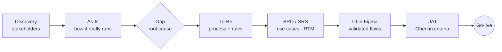
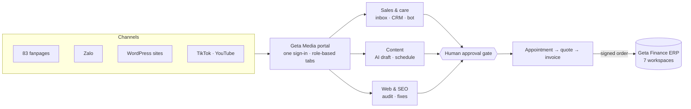

# Dao Thuy Bao Han

**Business Analyst · ERP, Fintech & EdTech**

*I go backstage to see how a business really runs, then write the setlist a dev team can play from:*
*As-Is / To-Be, BRD, UI, UAT and go-live.*

---

## 🎟️ Backstage pass

| | |
|---|---|
| **Full BA lifecycle** | discovery → BRD → UI → UAT → go-live, since 2023 |
| **4 industries** | ERP · Fintech · EdTech · Data |
| **Now** | Business Analyst at Geta Technology — Geta Finance (ERP) and Geta Media (sales & content portal) |
| **Education** | B.Sc. Computer Science, Ton Duc Thang University (2022 – 2026) |

**How I work** — every project starts from the problem, not the feature list:

---

## 🎤 The tour — experience

### Geta Technology · Business Analyst · *May 2026 → now*
A multi-industry group selling across **8 business lines** through **83 Facebook fanpages** and Zalo. I own requirements and quality for its two internal products.

- **The problem:** 83 inboxes with no single view, one customer scattered across pages, the same price questions typed by hand, orders written up twice, and finance built from separate spreadsheets.
- **Geta Media** — one portal, one sign-in, 9 tools: a shared inbox for every fanpage and Zalo, one profile per customer (merged by phone number), a bot with 3 modes that **never invents a price**, and chat → appointment → quote → invoice in a few clicks. Content (AI rewrite → human approval → Fanpage, YouTube, TikTok) and WordPress SEO fixes all pass the same approval gate.
- **Geta Finance (ERP)** — 7 role-based workspaces behind one login: Admin, Accounting, Warehouse, Employee, Field sales, Tasks and Orders (7 stages from site measurement to handover). Orders confirmed in Geta Media flow straight into it as signed events.
- Designed the workflow for an AI multi-agent system (1 orchestrator + 3 sub-agents) with guardrails: drafts queued for approval, unusual amounts blocked in code, no tools to delete or move money.

### International Link Corporation (Saigon Language School) · BA & Tester · *May 2025 → May 2026*
Replaced file-based operations — spreadsheets and shared OneDrive folders for **60+ instructors, ~4,000 learners and 30 corporate classes** — with one platform.
- Traced two business risks to their root cause: **instructor double-booking** and **file access never revoked** for leavers.
- Authored the BRD end to end: **40 functional requirements, 9 business rules, 8 NFRs across 7 modules, 9 actor roles**, MoSCoW-ranked and traced in an RTM — including rules that block double-booking at scheduling time and tie data access to roles.

### PiStudy Education and Solution JSC · BA & UI/UX Designer (freelance) · *Aug 2025 → Jan 2026*
Turned **6 K-12 programs into one product** with two very different ways in — student self-signup and provisioned teacher / institution accounts — on one user model. Designed the sign-up and login UI with its validation rules in Figma. **Live at Huỳnh Khương Ninh Secondary School, ~1,000 students across 4 grades.**

### MindX Technology School · Coding & Robotics Instructor · *Mar 2024 → now*
~30 classes, ~210–240 students aged 4–18, **100% course completion**. Sole point of contact for parents: flag students early, agree a support plan, check it worked — the same loop a BA runs with stakeholders.

### Pulse Active · Data Analyst Intern · *2023 → 2024*
Cleaned and cross-checked registration data for marathons of **10,000+ and 9,000+ runners**, catching duplicates and payment mismatches before race day; built the dashboards leadership used for go / no-go decisions.

---

## 🎬 The B-sides — projects

▶ <b>Now screening</b> · Tech Store — the Android app, live on one Firestore source of truth

| Project | Problem → outcome | |
|---|---|---|
| **Banking Automation** · Lead BA | Manual KYC, Excel reconciliation and card limits with no concurrency control → a BRD that automates all three: **30 requirements, 18 use cases, 26 business rules, 18 Gherkin stories**. AML/PEP rule independent and non-overridable; the race-condition risk turned into a measurable **< 2 s SLA**. Circular 17/2024/TT-NHNN, ISO 20022 / 8583, PCI DSS. | eKYC demo on the [portfolio](https://dao-thuy-bao-han.kamila-comme.workers.dev) |
| **[Library Management](https://github.com/handao2303/library-management-system)** | Business rules (borrow quotas, FIFO approval, penalties) turned into a layered test strategy: **42 unit, 17 integration / E2E, 14 exploratory** cases in CI. Found and fixed a privilege escalation, a broken-access-control gap and an integer overflow in a DB trigger. | NestJS · React · GitHub Actions |
| **[Tech Store](https://github.com/handao2303/tech-store-cross-platform)** | Web admin + native Android app on one Firestore source of truth: 4 services, Stripe checkout, real-time stock, chat and campaigns — documented as an architecture dossier. | React · Express · Android · Firebase |
| **[TaskFlow](https://github.com/handao2303/taskflow-saas-metrics)** | A raw Stripe-style ledger → 8 SaaS metrics reconciled to **$0 variance**. Finding: MRR **~70x** but NRR only **98.7%**; Referral LTV:CAC **28.7 : 1** vs Paid Ads 2.0 : 1. Written as Finding → So what → Recommendation. | Python · pandas · Streamlit |

---

## 🧰 Toolkit

**Analysis** &nbsp;

**Tools** &nbsp;

**Certifications** — Google Data Analytics: Foundations · Agile Scrum Master (Techbase Vietnam)

---

*Got a product that needs a BA who goes backstage?*
**[Send me the brief →](mailto:baohandao2303@gmail.com)** &nbsp;·&nbsp; **[See the full show →](https://dao-thuy-bao-han.kamila-comme.workers.dev)**

