

# Dao Thuy Bao Han

**Business Analyst · ERP, Fintech & EdTech**

*I go backstage to see how a business really runs, then write the setlist a dev team can play from:*
*As-Is / To-Be, BRD, UI, UAT and go-live.*

---

## 🎟️ At a glance

| | |
|---|---|
| **Role** | Business Analyst — discovery → BRD → UI → UAT → go-live |
| **Industries** | ERP · Fintech · EdTech · Data |
| **Now** | Business Analyst at **Geta Technology** — Geta Finance (ERP) and Geta Media (sales & content portal) |
| **Proof in numbers** | 3 BRDs · 40 + 30 requirements · 35 business rules · 18 use cases · 18 Gherkin stories · a platform live for ~1,000 students |
| **Education** | B.Sc. Computer Science, Ton Duc Thang University (2022 – 2026) |

### How I work
Every engagement starts from the problem, not the feature list — and every requirement stays traceable to the test that proves it.

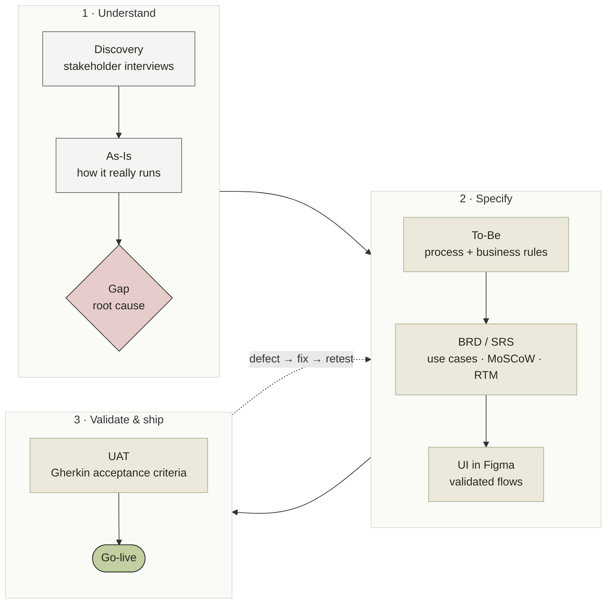

---

## 🎤 Experience

### Geta Technology — Business Analyst · *May 2026 → now*
A multi-industry group (F&B, advertising, interior) selling across **8 business lines** through **83 Facebook fanpages** and Zalo. I own requirements and quality for its two internal products.

**Problem** — 83 inboxes with no single view; one customer scattered across pages; the same price questions typed by hand; every confirmed order re-entered 2–3 times; stock, sales, cash, timekeeping and payroll in separate spreadsheets.

- **Geta Media** — one portal, one sign-in, 9 tools: a shared inbox for every fanpage and Zalo, one profile per customer (merged by phone number), a bot with 3 modes that **never quotes a price on its own**, and chat → appointment → quote → invoice in a few clicks. AI-written content and website fixes pass the same human approval gate.
- **Geta Finance (ERP)** — mapped the operating flow *Inventory → Sales & Revenue → Income & Expense → Timekeeping → Payroll* and split it into **7 role-based workspaces**; each order moves through **7 stages** from site measurement to handover.
- **Media → ERP contract** — confirmed orders reach the ERP as signed events (4 event types, HMAC signature, idempotency key, retries 1 → 180 min), so nothing is entered twice.
- **Quality** — functional testing and UAT before every release; fixes verified with developers to protect live finance, stock and payroll data.

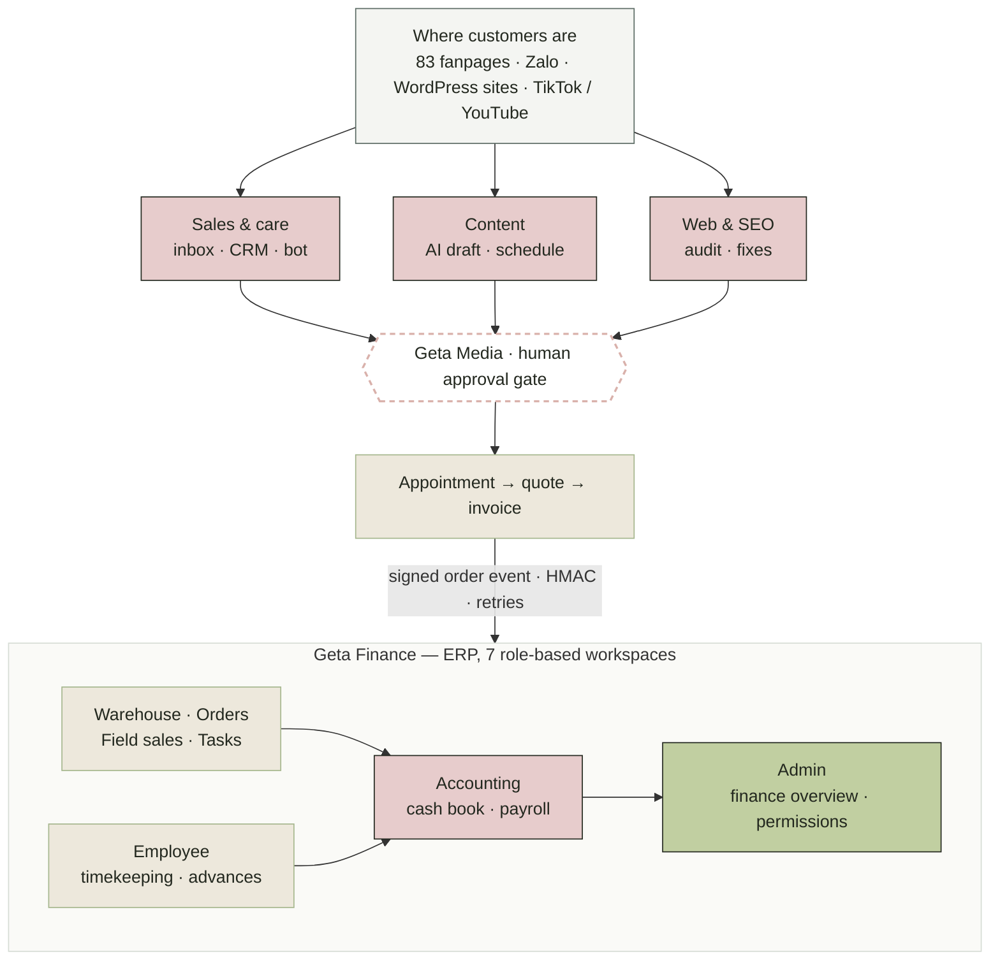

**Outcome** — one portal for all 8 business lines; a confirmed chat becomes an appointment, an invoice and an ERP order in a few clicks; finance reports come from one flow instead of spreadsheets.

### International Link Corporation (Saigon Language School) — BA & Tester · *May 2025 → May 2026*
**Problem** — scheduling, enrollment and file access for **60+ instructors, ~4,000 learners and 30 corporate classes** ran on spreadsheets and shared OneDrive folders, with no single source of truth.

- Interviewed stakeholders across **9 roles**, mapped the As-Is and traced it to two business risks: **instructor double-booking** and **file access never revoked** for leavers.
- Authored the BRD end to end — **40 functional requirements, 9 business rules, 8 NFRs, 7 modules** — prioritized with MoSCoW and traced in an RTM; designed the To-Be and full UI, validated with stakeholders before build.

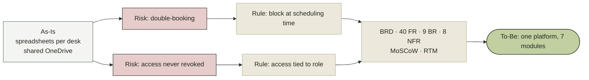

### PiStudy Education and Solution JSC — BA & UI/UX Designer (freelance) · *Aug 2025 → Jan 2026*
**Problem** — six K-12 programs with no shared structure, and two very different ways in.
Consolidated **6 programs into one information architecture** and designed **2 onboarding paths** on a single user model; wireframed the sign-up / login UI with validation rules in Figma and ran functional and usability testing. **Live at Huỳnh Khương Ninh Secondary School — ~1,000 students across 4 grades.**

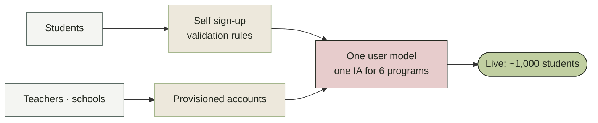

### Pulse Active — Data Analyst Intern · *2023 → 2024*
Cleaned and reconciled registration data for marathons of **10,000+ and 9,000+ runners** — catching duplicates and payment mismatches **before race day** — and built the dashboards leadership used for go / no-go decisions.

<b>Diagram</b>

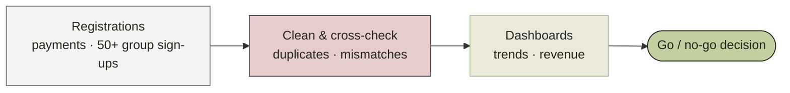

### MindX Technology School — Coding & Robotics Instructor (part-time) · *Mar 2024 → now*
~30 classes, ~210–240 students aged 4–18, **100% course completion**. Sole point of contact for parents — the same loop a BA runs with stakeholders.

<b>Diagram</b>

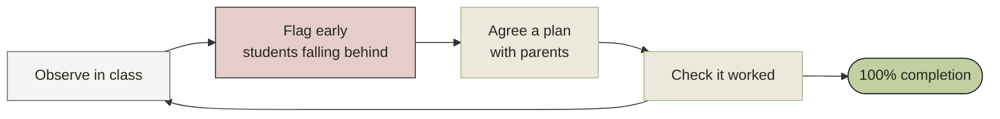

---

## 🎬 Projects

### Banking Automation System — Lead BA
**Problem** — account opening checked by hand against disconnected CIC/AML portals; reconciliation in Excel; card limits updated in an end-of-day batch with no concurrency control.
A BRD that automates all three: **30 requirements, 18 use cases, 26 business rules, 18 Gherkin user stories**. The AML/PEP rule is independent and non-overridable; the race-condition risk became a measurable **< 2 s response SLA**. Scope: Circular 17/2024/TT-NHNN, ISO 20022 / 8583, PCI DSS. eKYC demo on the [portfolio](https://dao-thuy-bao-han.kamila-comme.workers.dev).

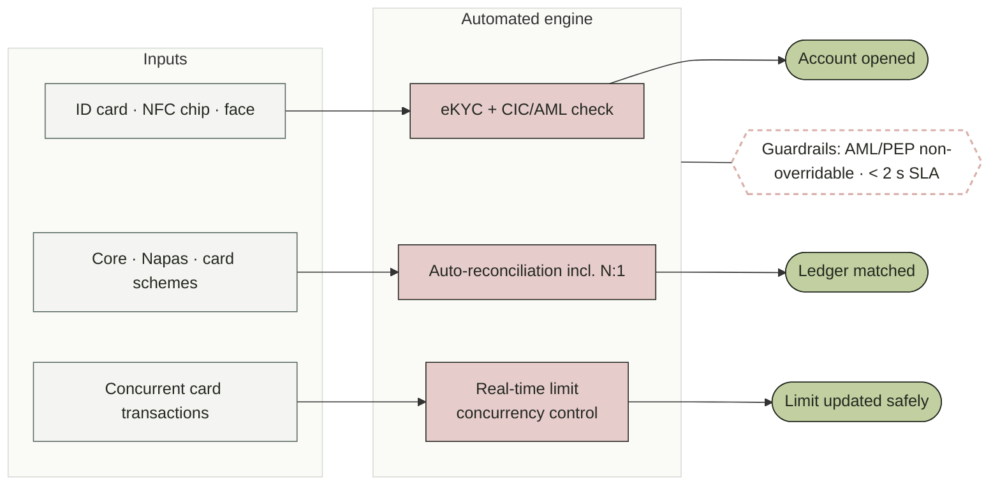

### [Checkpoint](https://github.com/handao2303/checkpoint-app) — travel social app for Vietnam · [live ↗](https://checkpoint-app.space)

**Problem** — trip memories with no map, discovery not tied to location, and no reason to go again.
Check in on a map, follow journeys, earn XP and badges, and collect a stamp for every province on a digital travel passport. Product documentation in the [hub repo](https://github.com/handao2303/checkpoint-app): problem framing, a **7-phase, 16-feature roadmap** with an explicit “won’t do” list, a plan per feature and a status log kept current. Go API · React PWA · PostGIS · Cloud Run — about **$0 a month** to run.

**Source:** [docs & design](https://github.com/handao2303/checkpoint-app) · [Go backend](https://github.com/handao2303/checkpoint-app-go) · [React web](https://github.com/handao2303/checkpoint-app-reactjs) · [React Native](https://github.com/handao2303/checkpoint-app-rn) · [Flutter](https://github.com/handao2303/checkpoint-app-flutter)

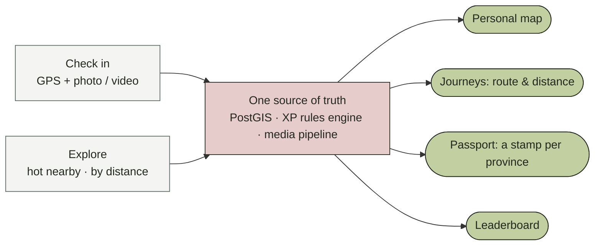

### [Library Management](https://github.com/handao2303/library-management-system) — business rules turned into tests
Borrow quotas, FIFO approval and penalties became a layered strategy of **42 unit, 17 integration / E2E and 14 exploratory** cases running on every commit. Found and fixed **3 critical defects**: a privilege escalation, a broken-access-control gap and an integer overflow in a SQL Server trigger. *NestJS · React · GitHub Actions*

<b>Diagram</b>

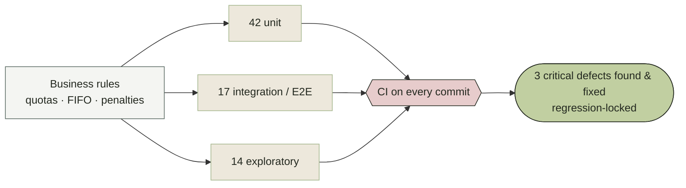

### [Tech Store](https://github.com/handao2303/tech-store-cross-platform) — one source of truth for web and Android
Web admin and a native Android app on one Firestore: 4 services, Stripe checkout, real-time stock, chat and campaigns — documented as an architecture dossier. *React · Express · Android · Firebase*

<b>Diagram</b>

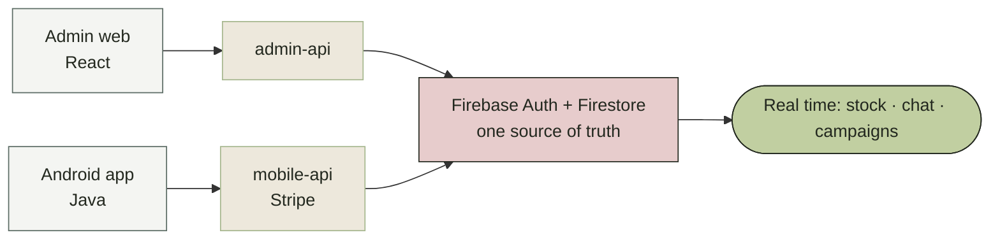

### [KKBox Subscription Analytics](https://github.com/handao2303/taskflow-saas-metrics) — 430M rows of billing logs, no metric pre-computed
**Problem** — revenue keeps growing, but where is it leaking, which users are worth keeping, and what should the business fix first?
MRR, churn, NRR, cohorts and LTV rebuilt from **23M payments and 410M listening logs** (32 GB → 8.2 GB Parquet with DuckDB), with every metric definition and analysis decision written down. Findings: MRR **104.5M → 151.1M NTD (+44.5%)** yet NRR **94.8%** — the base shrinks ~5% a month; **15% of paid churn is payment-partner outages**, not users leaving; auto-renew users are worth **3.6×** manual payers. Tracked phase by phase in Jira — churn model and dashboard in progress. *Python · DuckDB · Parquet · Streamlit*

<b>Diagram</b>

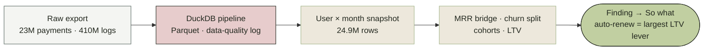

---

## 🧰 Toolkit

**Analysis** &nbsp;

**Tools** &nbsp;

**Certifications** — Google Data Analytics: Foundations (Google) · Agile Scrum Master (Techbase Vietnam)

---

*Got a product that needs a BA who goes backstage?*
**[Send me the brief →](mailto:baohandao2303@gmail.com)** &nbsp;·&nbsp; **[See the full show →](https://dao-thuy-bao-han.kamila-comme.workers.dev)**

